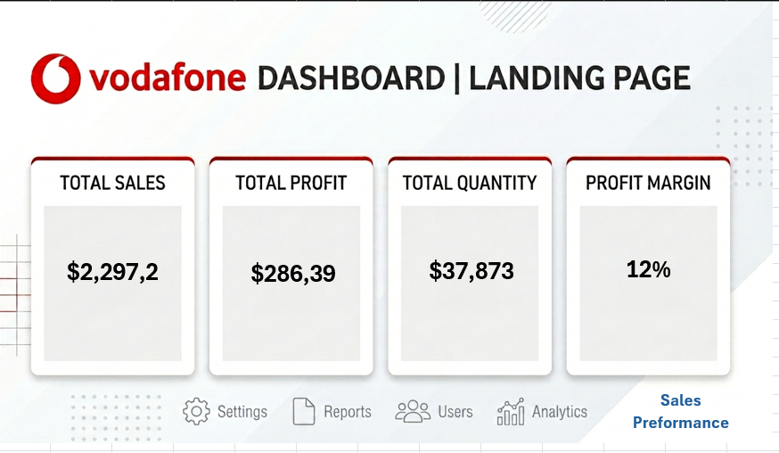
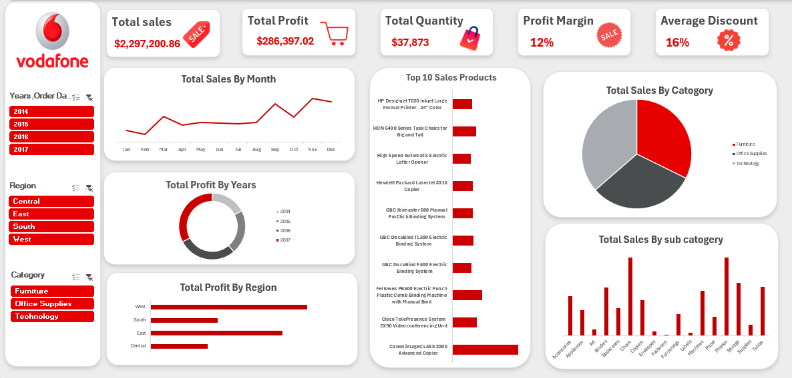

# 📊 Vodafone Transaction Analysis Dashboard

An interactive **Excel dashboard** built with **Pivot Tables and Pivot Charts** to analyze Vodafone transaction data, covering sales, profit, quantity, discounts, and performance across time, region, and product category.

---

## 📌 Table of Contents
- [Project Overview](#-project-overview)
- [Business Objectives](#-business-objectives)
- [Tools & Techniques](#-tools--techniques)
- [Dashboard Structure](#-dashboard-structure)
- [Key Performance Indicators](#-key-performance-indicators)
- [Key Insights](#-key-insights)
- [Recommendations](#-recommendations)
- [Interactive Features](#-interactive-features)
- [Repository Structure](#-repository-structure)
- [How to Use](#-how-to-use)
- [Author](#-author)

---

## 📖 Project Overview

This project analyzes Vodafone transaction data from **2014 to 2017** to help decision-makers understand business performance at a glance. The workflow covers data cleaning, summarizing with Pivot Tables, visualizing with Pivot Charts, and combining everything into a two-page interactive dashboard:

1. **Landing Page** – high-level KPI cards and navigation (Settings, Reports, Users, Analytics, Sales Performance).
2. **Sales Performance Dashboard** – detailed charts with slicers for deeper exploration.

---

## 🎯 Business Objectives

- Track overall **sales, profit, quantity sold, profit margin, and average discount**.
- Identify **sales trends** across months and years.
- Compare **profitability by region** and **category**.
- Find the **top-selling products** and strongest **sub-categories**.
- Provide an interactive tool so stakeholders can filter data by **year, region, and category**.

---

## 🛠 Tools & Techniques

| Tool / Feature | Purpose |
|---|---|
| **Microsoft Excel** | Main analysis and dashboard platform |
| **Pivot Tables** | Aggregating sales, profit, quantity, and discount data |
| **Pivot Charts** | Line, donut, pie, and bar/column charts linked to the pivots |
| **Slicers** | Interactive filtering by Year, Region, and Category |
| **Calculated Fields / Formulas** | Profit Margin (Profit ÷ Sales) and Average Discount |
| **Data Cleaning** | Removing duplicates, fixing data types, and standardizing fields |
| **Dashboard Design** | Custom layout using Vodafone's red / grey / white brand colors |

---

## 🗂 Dashboard Structure

### Page 1 – Landing Page
KPI cards for **Total Sales, Total Profit, Total Quantity, and Profit Margin**, plus a navigation bar linking to Settings, Reports, Users, Analytics, and Sales Performance.

 

### Page 2 – Sales Performance Dashboard
Includes the following visuals:

| Visual | Chart Type | What It Shows |
|---|---|---|
| Total Sales By Month | Line chart | Monthly sales trend |
| Total Profit By Years | Donut chart | Profit share per year (2014–2017) |
| Total Profit By Region | Horizontal bar | Profit by Central, East, South, West |
| Top 10 Sales Products | Horizontal bar | Best-selling products |
| Total Sales By Category | Pie chart | Furniture vs. Office Supplies vs. Technology |
| Total Sales By Sub-Category | Column chart | Sales across 17 sub-categories |

 

---

## 📈 Key Performance Indicators

| KPI | Value |
|---|---|
| 💰 **Total Sales** | **$2,297,200.86** |
| 📦 **Total Profit** | **$286,397.02** |
| 🛒 **Total Quantity** | **37,873 units** |
| 📊 **Profit Margin** | **12%** |
| 🏷 **Average Discount** | **16%** |

---

## 🔍 Key Insights

> Insights below are read from the dashboard visuals; exact values can be checked in the pivot tables inside the workbook.

### 1. Overall Performance
- The business generated about **$2.3M in sales** and **$286K in profit**, a **12% profit margin**.
- With an **average discount of 16%**, discounting is likely putting pressure on margins and is worth monitoring.

### 2. Sales Trend (Monthly)
- Sales are **lowest in the early months** (January–February) and **grow through the year**.
- Sales rise strongly in the **second half of the year**, peaking in **September and November**, which points to **seasonal demand** toward year-end.

### 3. Profit by Year
- Profit is distributed across all four years (2014–2017), with **2017 contributing the largest share** and **2014 the smallest**, which indicates **business growth over time**.

### 4. Regional Performance
- The **West** region delivers the **highest profit**, followed by the **East**.
- **Central** shows the **lowest profit**, followed by the **South**, so these regions have room for improvement.

### 5. Category Performance
- Sales are **fairly balanced across Furniture, Office Supplies, and Technology**, so no single category dominates revenue.

### 6. Sub-Category Performance
- **Chairs, Phones, Storage, Binders, and Tables** are among the **highest-selling sub-categories**.
- **Fasteners, Labels, Art, and Envelopes** are among the **lowest**.

### 7. Top Products
- The **Canon imageCLASS 2200 Advanced Copier** is the **top-selling product**.
- The top 10 list is dominated by **office technology and equipment** (copiers, binding systems, printers, and telepresence units), which shows strong demand for high-value business equipment.

---

## 💡 Recommendations

1. **Plan for seasonality** – increase stock, marketing, and staffing ahead of the September–November peak.
2. **Review discount strategy** – a 16% average discount against a 12% margin suggests testing tighter discount limits on low-margin items.
3. **Support weaker regions** – investigate why Central and South lag behind West and East, and replicate West's best practices.
4. **Prioritize high-performing products** – focus promotions and inventory on top products and best sub-categories (Chairs, Phones, Storage).
5. **Reassess low-selling items** – consider bundling or reducing investment in low-volume sub-categories.

---

## 🎛 Interactive Features

Slicers on the left side of the dashboard let users filter every chart at once:

- 📅 **Year (Order Date):** 2014, 2015, 2016, 2017
- 🌍 **Region:** Central, East, South, West
- 🗃 **Category:** Furniture, Office Supplies, Technology

---

## 📁 Repository Structure

```
📦 vodafone-transaction-analysis
 ┣ 📂 data
 ┃ ┗ 📄 vodafone_transactions.xlsx      # Raw / cleaned dataset
 ┣ 📂 dashboard
 ┃ ┗ 📄 Vodafone_Dashboard.xlsx         # Excel file with pivot tables, charts & slicers
 ┣ 📂 images
 ┃ ┣ 🖼 landing_page.png
 ┃ ┗ 🖼 dashboard.png
 ┗ 📄 README.md
```

> Update the file and folder names above to match your repository.

---

## ▶️ How to Use

1. **Download or clone** the repository:
   ```bash
   git clone https://github.com/<your-username>/<your-repo-name>.git
   ```
2. Open **`Vodafone_Dashboard.xlsx`** in Microsoft Excel (2016 or later recommended).
3. Enable **editing and content** if prompted.
4. Use the **slicers** on the left to filter by Year, Region, and Category.
5. Go to the **Pivot Table sheets** to see the underlying calculations.

---

## 👤 Author

**Your Name**
Data Analyst

🔗 [LinkedIn](https://linkedin.com/in/your-profile) | 📧 your.email@example.com | 💻 [GitHub](https://github.com/your-username)

---

⭐ If you found this project useful, please give it a star!
